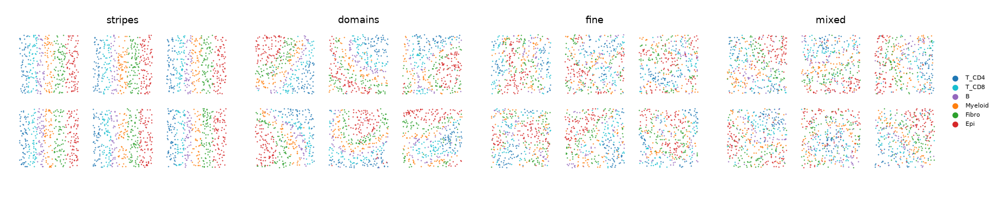

# scCube world - realistic expression and tissue geometry for the synthetic sweep

The toy world (`benchmarks/synthetic/sim.py`) puts six types in stripes with Poisson counts and markers at
1,000× their off-target rate. This world keeps the same contract and the same 15 scenarios, but:

- **expression** comes from scCube (Qian et al., *Nat Commun* 2024): a VAE trained on real annotated
  scRNA-seq (Yerly et al. 2022, basal cell carcinoma), on a real imaging panel (the 10x Xenium human breast
  panel, 306 of its 313 genes), with counts drawn at the depth of a real Xenium section;
- **tissue geometry** comes from scCube's spatial-pattern generator, in four patterns: `stripes`, `domains`,
  `fine` and `mixed`;
- **the reference** is real held-out scRNA-seq cells, which the VAE never saw.



Each section has 2,400 cells in six tiles. Each tile is one sample with its own scCube pattern, and every
type is present in every tile.

| pattern | scCube call | kNN-6 same type | Moran's I, median gene | Moran's I, median marker |
|---|---|---|---|---|
| `stripes` | `SPatternGeneratorCustom.simulate_stripes`, purity 1 (the toy geometry, transposed so types change along x) | 0.84 | 0.106 | 0.47 |
| `domains` | `generate_pattern_random`: GRF, `delta` 25, `lamda` 1 (few large graded domains) | 0.70 | 0.088 | 0.39 |
| `fine` | GRF, `delta` 6, `lamda` 1 (many small patches: a higher spatial resolution) | 0.53 | 0.061 | 0.22 |
| `mixed` | GRF, `delta` 25, `lamda` 0.7 (the domains with 30 % of labels permuted) | 0.44 | 0.043 | 0.19 |
| toy stripes | - | 0.94 | 0.096 | 0.89 |
| real Xenium breast (800 / 1,200 µm windows) | - | n/a | 0.106 / 0.124 | n/a |

How scCube's GRF works: a Gaussian random field on a 30 × 30 grid, with squared-exponential covariance and
length scale `delta`. The types fill successive quantile bands of the field in `sim.TYPES` order, so
neighbouring types share borders as in the toy. `lamda` is the share of cells that keep their band label; the
rest are permuted. At 400 cells per tile, six bands are about three cells wide. Combined with scCube's
proportion correction, which relabels surplus cells at random, about 18 % of `domains` cells differ from
their 10-NN majority (one test tile). At 4,000 cells per tile it would be 5 %. So `domains` means graded domains at the scale of a
400-cell sample, not large uniform regions.

## Build and run

scCube is not on PyPI. The authors distribute it as source on GitHub (README: `python setup.py install`), and
its `setup.py` declares no dependencies. Install it into a separate venv:

```bash
uv venv --python 3.10 venv-sccube
uv pip install --python venv-sccube/bin/python "git+https://github.com/ZJUFanLab/scCube"   # d5b423d, sccube 2.0.0
uv pip install --python venv-sccube/bin/python "torch==2.4.1" --index-url https://download.pytorch.org/whl/cu121 \
    --extra-index-url https://pypi.org/simple
uv pip install --python venv-sccube/bin/python anndata==0.8.0 numpy==1.23.5 pandas==1.5.3 scanpy==1.9.1 \
    pot==0.8.2 "tqdm>=4.66.3" matplotlib==3.6.3 seaborn==0.12.2 "scipy<=1.13.1" scikit-learn==1.3.2   # its requirements.txt
```

1. **Export the reference** from the published Seurat object: `counts.mtx`, `genes.txt`, and `meta.csv` with
   `annotation`, `scGate_multi` and `patient_bcc` (R: `Matrix::writeMM(x@assays$RNA@counts, ...)`).
2. **Generate the cache** (scCube venv, one GPU; torch 2.4 has no kernels for Blackwell GPUs, so use an L40S):
   `python benchmarks/worlds/sccube/generate.py --yerly <export dir> --device cuda:0`.
   The cache (about 200 MB of h5ad and csv.gz) goes to `benchmarks/worlds/sccube/cache/` (git-ignored; a
   symlink works) or wherever `--out` / `SAM_SCCUBE_CACHE` point. `world.py` only reads it and needs only the
   normal environment.
3. **Run the sweep, one pattern at a time:**
   `PYTHONPATH=src python benchmarks/worlds/sccube/run.py --pattern domains --seeds 3 --workers 16 --out <dir>`.
   `run.py` replaces `sim.simulate` / `sim.reference` (and `sim.marker_sets` / `sim.T_LINEAGE`, used by the
   panel check) with this world, then calls `sweep.main`. The workers are forked, so they inherit the patch. It
   also rewires the one edge case that names a toy gene (`all_zero_marker_gene`) to zero the first B marker.
4. **Summarise:** `realism.py --xenium <section.h5ad> --plot results/layouts.png` (realism table and layout
   figure) and `compare.py --toy3 results/toy3` (verdict changes).

## Generation settings

**Reference: Yerly 2022 BCC scRNA-seq, not the Xenium breast section.** Yerly is a real dissociated reference
with the authors' annotation, and its types map one to one onto the six names the scenarios hard-code:

| world type | Yerly cells | train / reference half |
|---|---|---|
| `T_CD4` | `Tcell` ∩ scGate `CD4T` | 2,901 / 2,901 |
| `T_CD8` | `Tcell` ∩ scGate `CD8T` | 754 / 755 |
| `B` | `Bcell` + `PlasmaCell` | 274 / 274 |
| `Myeloid` | `MoMacDC` | 970 / 971 |
| `Fibro` | `Fibroblast` | 947 / 947 |
| `Epi` | `Cancer_cells` | 4,929 / 4,930 |

The local Xenium h5ad has no cell types, and its cells carry real segmentation spillover, so it cannot serve
as a clean world. It is used to calibrate the world: depth, depth spread, control rate and cell area.

- **Panel:** the 306 genes of the Xenium human breast panel present in Yerly. The 7 missing ones are renamed
  genes (`CLECL1`, `FAM49A`, `KARS`, `LARS`, `NARS`, `QARS`, `WARS`).
- **`panel_growth` genes:** the 960 genes with the lowest between-type F statistic, among genes detected in
  ≥ 10 % of training cells (ribosomal and mitochondrial genes excluded).
- **Marker sets** come from the reference half, as top mean log-expression in the type minus the highest
  other type, 4 per type. `T_CD4` and `T_CD8` share the two T-lineage genes, as in the toy.

  | type | markers |
  |---|---|
  | `T_CD4` | CD3D, CD3E, LTB, IL7R |
  | `T_CD8` | CD3D, CD3E, CCL5, NKG7 |
  | `B` | MZB1, CD79A, DERL3, MS4A1 |
  | `Myeloid` | LYZ, TYROBP, AIF1, FCER1G |
  | `Fibro` | LUM, PCOLCE, CCDC80, POSTN |
  | `Epi` | KRT14, KRT5, DSP, S100A14 |
- **VAE:** scCube's default architecture (2048-1024-512, latent 128). It is trained once on log1p CP10k
  (full-transcriptome library) of 7,445 training cells (at most 2,500 per type): 3,000 epochs, batch 512,
  lr 1e-4. Per seed, scCube generates 700 cells per type, with the training order permuted per seed so seeds
  draw different templates. Seeds therefore differ in the generated cells, the layout and the counts, but
  share one trained VAE.
- **Counts:**
  - Poisson(rate × scale × size). The scale gives a median of 164 transcripts per cell on the panel (Xenium
    breast: 164). The size factor is lognormal(0, 0.517), which brings the SD of log library size to 0.72
    (Xenium: 0.73).
  - The `extra_bg` genes are drawn from their own stream after the base genes, so the base panel's counts do
    not change with panel size.
  - Cell area is lognormal around 140 µm² and correlates 0.56 with log library size, as in the Xenium
    section.
- **Negative controls:** scCube has none. 20 `NegCtrl*` features are Poisson at the Xenium section's
  control-to-gene ratio, 0.0017 × the cell's mean count per panel gene (Xenium: 0.00105 counts per control
  feature per cell). This lets signal QC run.
- **Pre-built layouts:** 4 patterns × 5 seeds × {2,400 cells with the default weights and with each
  `rare_type` level; 600 cells for the edge cases}. That is 120 layouts.

**How each `simulate` keyword is honoured.** All 15 scenarios are supported.

| keyword | behaviour |
|---|---|
| `weights` | the pre-built vectors only; any other vector raises and names what exists |
| `n_cells` | 2,400 and 600 only |
| `n_samples` | 6 only (one per tile) |
| `infiltrate` | a fraction of T_CD8 cells swap positions with random non-T_CD8 cells anywhere in the section: scCube's `lamda` permutation, restricted to T_CD8 |
| `coexpr` | Myeloid rates gain `coexpr` × the mean Fibro rate on Fibro's markers; the reference gets the same share of its Fibro cells' marker counts |
| `extra_bg` | the first `extra_bg` of the 960 genes |

scCube's own per-type switch (`spatial_cell_type`) cannot implement `infiltrate`. With one type left out, it
permutes that type among its own positions, which is a no-op.

**Runtime:**

| step | where | time |
|---|---|---|
| R export | - | 1 min |
| prep | - | 14 s |
| VAE training | L40S | 248 s |
| pools, 5 seeds | L40S | 1 s |
| 120 layouts | - | 344 s |
| `world.simulate` | - | 0.2-1.3 s per section (first call loads the cache) |
| sweep, 15 scenarios × 3 seeds + edge cases + dedicated checks | 16 cores | 116-211 s per pattern (toy world, same settings: 101 s) |

## Realism

Source data: [`results/realism_summary.csv`](results/realism_summary.csv), 3 seeds. Columns:

- **sccube:** clean `domains` sections. Expression columns are identical across patterns.
- **real cells:** held-out Yerly cells.
- **Xenium:** a central window of the real section.

Zero fraction, overdispersion and marker detection all depend on depth, so the lower block thins every source
to 60 transcripts per cell.

| | toy | sccube | real cells | Xenium |
|---|---|---|---|---|
| median tx / cell (native) | 149 | 164 | 93 | 153 |
| SD log tx / cell | 0.31 | 0.72 | 0.78 | 0.67 |
| control / gene count ratio | 0.013 | 0.0019 | n/a | 0.0021 |
| *at 60 tx / cell:* zero fraction | 0.65 | 0.94 | 0.92 | 0.89 |
| overdispersion (var / mean, median gene) | 1.06 | 3.19 | 2.11 | 1.43 |
| overdispersion within type | 0.99 | 2.55 | 1.44 | n/a |
| marker specificity (on-type / off-type mean) | 978 | 87 | 63 | n/a |
| cells with ≥ 1 count of another type's marker | 0.08 | 0.23 | 0.40 | n/a |

- **Expression is far closer to real than the toy's, with two gaps:**
  - Markers are cleaner than real (specificity 87 vs 63; off-target detection 0.23 vs 0.40). The ReLU
    decoder outputs exact zeros.
  - Cells vary more within a type than real cells (overdispersion 2.5 vs 1.4). A likely cause: scCube divides
    its KL term by batch × genes, so the latent noise is barely regularised.
  - The 0.94 vs 0.89 zero fraction against Xenium is mostly the panel: breast genes are silent in BCC cells.
- **Spatial autocorrelation:** `stripes` (Moran's I 0.106) and `domains` (0.088) match the real breast
  section (0.106-0.124). `fine` and `mixed` are less autocorrelated than that tissue.
- **The reference is shallower than the section:** 93 vs 164 panel counts per cell. A 3' scRNA-seq library
  at 5,600 UMIs puts about 1.8 % of them on this panel. In the toy, the reference was deeper (400 vs 150).

## Metric behaviour per spatial pattern

Values are means over 3 seeds, shown as baseline → maximum strength. ✅ marks the strength at which the
metric first moves; verdict symbols are as in `benchmarks/synthetic/README.md`.

| metric × scenario | toy | stripes | domains | fine | mixed |
|---|---|---|---|---|---|
| `sc.mean_coherence`, clean | 0.920 | 0.796 | 0.654 | 0.472 | 0.416 |
| `sc.mean_coherence` × `label_noise` | ✅ 0.05 | ✅ 0.05 | ✅ 0.1 | ✅ 0.1 | ✅ 0.05 |
| `sc.mean_coherence` × `patch_error` | ❌ 0.920 → 0.920 | ❌ 0.796 → 0.808 | ❌ 0.654 → 0.680 | ❌ 0.472 → 0.512 | ⛔ 0.416 → 0.453 |
| `sc.mean_coherence` × `merge` | ⛔ 0.920 → 0.967 | ⛔ 0.796 → 0.917 | ⛔ 0.654 → 0.806 | ⛔ 0.472 → 0.678 | ⛔ 0.416 → 0.577 |
| `sc.mean_coherence` × `infiltration` | ⚠️ 0.25 | ⚠️ 0.1 | ⚠️ 0.5 | ⚠️ 0.25 | ⚠️ 0.25 |
| `sc.pas`, clean | 0.022 | 0.062 | 0.217 | 0.508 | 0.508 |
| `sc.pas` × `label_noise` | ✅ 0.05 | ✅ 0.05 | ✅ 0.1 | ✅ 0.1 | ✅ 0.05 |
| `sc.pas` × `merge` | ❌ 0.022 → 0.009 | ❌ 0.062 → 0.026 | ❌ 0.217 → 0.094 | ⛔ 0.508 → 0.221 | ⛔ 0.508 → 0.295 |
| `sc.pas` × `sibling_confusion` | 〰️ | 〰️ | ❌ | ❌ | ❌ |
| `sc.chaos` × `merge` | ❌ 0.036 → 0.036 | ❌ | ⛔ 0.040 → 0.036 | ⛔ 0.045 → 0.037 | ⛔ 0.061 → 0.047 |
| `sc.chaos` × `patch_error` | ❌ | ❌ | ❌ | ❌ | ⛔ 0.061 → 0.058 |
| `neighbor_contamination`, clean | 0.0003 | 0.0087 | 0.0085 | 0.0122 | 0.0123 |
| `neighbor_contamination` × `spillover` | ✅ 0.2 (→ 0.037) | ✅ 0.1 (→ 0.052) | ✅ 0.05 (→ 0.066) | ✅ 0.05 (→ 0.083) | ✅ 0.05 (→ 0.093) |
| `neighbor_contamination` × `patch_error` | ✅ 0.1 | 〰️ | ❌ | ❌ | ❌ |
| `neighbor_contamination` × `coord_shuffle` | ✔ | ⚠️ 1 (→ 0.019) | ⚠️ 1 (→ 0.018) | ⚠️ 1 (→ 0.020) | ⚠️ 0.5 (→ 0.018) |
| `neighbor_contamination` × `coexpression` | ✔ | ✔ | ⚠️ 0.4 | ⚠️ 0.4 | ⚠️ 0.4 |
| `ns.n_suspicious` × `sibling_confusion` | 〰️ | 〰️ | 〰️ | ✅ 0.5 | ✅ 0.5 |
| `ns.n_suspicious` × `infiltration` / `rare_type` | ✔ / ✔ | ⚠️ / ⚠️ | ⚠️ / ⚠️ | ⚠️ / ⚠️ | ⚠️ / ⚠️ |
| `crisp_purity` × `spillover` 40 % | 0.81 → 0.67 | 0.76 → 0.28 | 0.76 → 0.20 | 0.76 → 0.12 | 0.76 → 0.05 |
| `sig.moran_gap`, clean | 0.093 | 0.055 | 0.046 | 0.033 | 0.022 |
| `sig.moran_gap` × `spillover` 40 % (no claim) | 0.093 → 0.097 | 0.055 → 0.232 | 0.046 → 0.212 | 0.033 → 0.183 | 0.022 → 0.143 |
| `sig.moran_gap` × `ambient` | ❌ | 〰️ | ✅ 0.02 | 〰️ | 〰️ |
| `ext.spari` | same verdicts as the toy in every pattern | | | | |

What the geometry does to the spatial metrics:

1. **Baselines depend on tissue architecture.** PAS on correctly labelled cells is 0.022 in toy stripes,
   0.217 in `domains` and 0.508 in `fine` and `mixed`: half the cells of a correct annotation read as
   "abnormal". Coherence falls from 0.92 to 0.42 the same way. An absolute coherence or PAS value cannot be
   read without the tissue's own geometry.
2. **Merging labels looks like an improvement, more so in mixed tissue.** Coherence rises 0.80 → 0.92
   (`stripes`) and 0.42 → 0.58 (`mixed`). PAS and CHAOS go from ❌ to ⛔ in the patchier patterns. In the toy,
   only coherence moved the wrong way.
3. **A compact mislabelled patch is still invisible** (coherence, PAS and CHAOS ❌ in every pattern). In
   `mixed` it reads as *better* (⛔ on all three): relabelling a contiguous block of a mixed region makes it
   more uniform. `neighbor_contamination`, which caught the patch in the toy (✅ 0.1), is blind in every GRF
   pattern.
4. **Correctly labelled infiltration is a false alarm in every geometry** (coherence, PAS, CHAOS), as in the
   toy. In `stripes` it fires earlier (0.1 vs 0.25), plausibly because the T_CD8 stripe is narrow and every
   displaced cell lands among other types.
5. **`neighbor_contamination`:**
   - Its clean baseline is 30-40× the toy's (0.009-0.012 vs 0.0003), because real cells express other types'
     markers at low levels.
   - It now raises false alarms under `coord_shuffle`, where only coordinates change (0.0085 → 0.018), and
     under co-expression in the GRF patterns. Both are the same mechanism: new neighbours of other types
     whose markers the cell already expresses a little.
   - Its response to spillover grows with mixing (0.037 toy → 0.093 `mixed`).
6. **Purity metrics measure tissue mixing as much as segmentation.** The same 40 % spillover takes
   `crisp_purity` from 0.76 to 0.28 in `stripes` and to 0.05 in `mixed`. `mecr` goes 0.038 → 0.18 vs → 0.35,
   and `pmp` 0.89 → 0.83 vs → 0.65. The toy's stripes, where a cell's neighbours are mostly its own type,
   understated all three.
7. **Spillover inflates Moran's signal gap** (no claim is made). `sig.moran_gap` rises 4-6× under 40 %
   spillover in every scCube pattern (0.046 → 0.212 in `domains`), and stayed flat in the toy. Bleed between
   neighbours smooths expression in space, so a segmentation problem reads as stronger spatial signal.
8. **`neighborhood_sanity` false-alarms** under `rare_type` and `infiltration` in every pattern (0 → 0.3-1
   suspicious types; ✔ in the toy). It catches `sibling_confusion` in `fine` and `mixed` (✅ 0.5).

## Verdict changes vs the toy matrix

Counted over the 535 scenario × metric cells that carry a claim. Source data:
[`results/verdict_counts.csv`](results/verdict_counts.csv),
[`results/verdict_changes.csv`](results/verdict_changes.csv), and per pattern `results/<pattern>/matrix.md`.

| | ✅ | ❌ | ⚠️ | ⛔ | 〰️ | ✔ | ↗ |
|---|---|---|---|---|---|---|---|
| toy, 5 seeds (`benchmarks/synthetic/results`) | 134 | 61 | 22 | 3 | 35 | 280 | 0 |
| toy, 3 seeds (control) | 134 | 58 | 21 | 3 | 38 | 276 | 5 |
| scCube `stripes` | 125 | 48 | 27 | 5 | 55 | 270 | 5 |
| scCube `domains` | 129 | 47 | 28 | 5 | 52 | 270 | 4 |
| scCube `fine` | 130 | 42 | 28 | 6 | 55 | 267 | 7 |
| scCube `mixed` | 129 | 41 | 29 | 9 | 54 | 266 | 7 |

- **How much changes:**
  - Against toy-5, 63 (`domains`) to 76 (`mixed`) of the 535 cells change verdict.
  - Seed count alone (toy at 3 vs 5 seeds) changes 13, and 60-73 of each pattern's changes are cells where
    toy-3 keeps the toy-5 verdict.
  - 55 cells change in all four patterns, 47 of them to the same new verdict. Those are expression effects,
    since `stripes` keeps the toy geometry.
- **What changes by kind:**
  - Blind cells fall from 61 to 41-48.
  - False alarms rise from 22 to 27-29.
  - Wrong-way cells rise from 3 to 5-9, most in `mixed`.
- **On the spatial metrics alone** (coherence, PAS, CHAOS, `neighbor_contamination`, `neighborhood_sanity`,
  Moran gap, fraction above controls, spARI):
  - stable cells fall from 35 to 27-32;
  - false alarms rise from 3 to 6-8;
  - wrong-way cells rise from 1 to 1-6.

Expression effects (the same in all four patterns; `domains` values shown, toy in brackets):

- **Real overlap between T_CD4 and T_CD8 hides sibling confusion.** At 75 % sibling confusion:
  - `iv.neighborhood_purity` is ❌ (0.883 → 0.890), where the toy detected it (1.000 → 0.944);
  - `iv.avg_similarity` is ❌ (0.767 → 0.752; toy ✅);
  - `nmp` is ❌ (0.998 → 0.989; toy ✅ 1.000 → 0.968).
- **`nmp` moves but stays under the move rule** for `patch_error` (0.998 → 0.957) and `sibling_confusion`.
  Depth loss stretches its range, so 5 % of the range is 0.066, against a move of 0.041. It still catches
  spillover in the GRF patterns (0.998 → 0.889, and → 0.734 in `mixed`), but not in `stripes`
  (0.997 → 0.952).
- **New detections:**
  - cLISI catches `patch_error` (0.997 → 0.974; toy stuck at 1.000).
  - `pmp` catches `over_split` (0.894 → 0.827): the dictionary-coverage gap the toy needed `no_dict_frac` for.
  - `coex.global` and `coex.by_type` catch spillover (0.985 → 0.973; toy blind, finding 6).
- **Lost detections:**
  - `ncp.moldia` loses spillover (0.666 → 0.659; toy ✅ 1.000 → 0.962). Its clean value is already 0.666.
  - `fid.mean_cohens_d` loses `over_split` in `stripes` and `domains` (2.18 → 2.19; toy 6.14 → 5.54; 〰️ in
    `fine` and `mixed`). Real marker effect sizes are about a third of the toy's.
- **Toy false alarms that disappear:**
  - silhouette, `iv.integrated` and isolated-label ASW stop moving under `rare_type` and co-expression
    (silhouette 0.297 → 0.303; toy 0.404 → 0.310);
  - Under `rare_type`, Calinski-Harabasz (⚠️), `cal.ece` (⚠️, 0.039 → 0.030) and `fid.mean_cohens_d` (↗) move
    instead in `domains`, `fine` and `mixed`; Ward-PropMatch keeps the toy's ⚠️ there.
- **New false alarms under `panel_growth`.** ISCG and `isc.integrated` fall from 0.898 to 0.677 with 960
  real low-F genes added (toy 0.937 → 0.925). Real "uninformative" genes still differ between types and
  samples. Ward-PropMatch (all four patterns) and orbital-medoid (the GRF patterns) follow.
- **`onto.rho` works for the first time.** The clean value is 0.61, against 0.25 in the toy, where centroids
  were equidistant. The real embedding has lineage structure: the T subtypes are close, then the other immune
  types, then the structural types. But `patch_error` makes it rise (⛔ 0.609 → 0.721), and `label_noise`
  barely moves it (0.609 → 0.653, 〰️).
- **Purity under co-expression still false-alarms** as in the toy: `crisp_purity` 0.758 → 0.681, `mecr`
  0.038 → 0.076, `pmp` 0.894 → 0.857. `nmp` stays flat.
- **Signal QC under ambient noise improves:** `sig.moran_gap` ✅ in `domains` (0.046 → 0.020) and
  `sig.frac_above_ctrl` ✅ (0.911 → 0.512), both from 0.02; in the other patterns they move but not
  monotonically (〰️). Both were ❌ in the toy. Real controls sit at 0.0019 of the gene level, not 0.013, so
  plausibly the same ambient load is a larger shift relative to them.
- **Annotator checks** (classifier trained on real cells, applied to VAE cells):
  - `cal.ece` starts at 0.039, against 0.0006 in the toy.
  - `nov.frac_novel` is 0 in every scenario except `ambient` (→ 0.99 at 0.2). It no longer flags `batch`
    (toy 0 → 0.88).
  - In `check_conformal.csv`, conformal novelty flags **no** cell, even with B held out (AUC 0.70-0.90). VAE
    cells lie closer to the reference's principal subspace than the real reference cells do, so on this
    world the novelty check cannot fire.

Dedicated checks (`results/<pattern>/check_*.csv`):

- **ISC regimes:** the clean world calls `B` `split` in 3/3 seeds (ISCG 0.71). B lumps naive B and plasma
  cells, which are two real programmes, so this is correct, and it is a case the toy could not contain. A
  batch effect at log-sd 1.0 leaves the calls exactly as on the clean section (B `split`, the rest
  `consistent`), where the toy read `split` for 18/18 type-seeds.
- **Panel resolvability:** with every private marker removed, macro-F1 is still 0.94 at depth 50 (toy 0.71).
  A real 306-gene panel is redundant. T_CD4 is T_CD8's confuser in all 47 of the 48 runs that name one.
- **Deconvolution:** monotone as in the toy (R² 1.00 → 0.63 at 50 % noise, → −0.47 at pure noise).

## Limits

- **One trained VAE for all seeds.** Seeds differ in the generated cells, the layout and the counts.
- **The expression gaps listed above** (markers cleaner than real, within-type variability higher) and a
  breast panel on skin-cancer cells.
- **Every tile is a 400-cell sample.** The domains are therefore narrow; see "How scCube's GRF works" above.
- **`stripes` places cells with Poisson noise**, while the GRF patterns place exact counts. Non-spatial
  verdicts can flip between `stripes` and the others through threshold noise alone (for example
  `fid.mean_auc` under co-expression).
- **`patch_error` takes the rightmost Fibro cells** (`sim.py`). With 3 × 2 tiles, that is the Fibro region of
  the two right-hand tiles: still compact, but at the Epi border only in `stripes`.
- **`infiltrate` swaps T_CD8 with random cells**, so the vacated T_CD8 positions are filled by other types
  rather than left empty as in the toy.
- **The reference has 274 B-lineage cells.** `n_per_type` above 274 gives fewer B cells, and the conformal
  check's second reference (`seed + 100`) shares cells with the first.
- **3 seeds against the toy's 5.** The toy-3 control bounds the seed-count effect at 13 of 535 claim cells.
